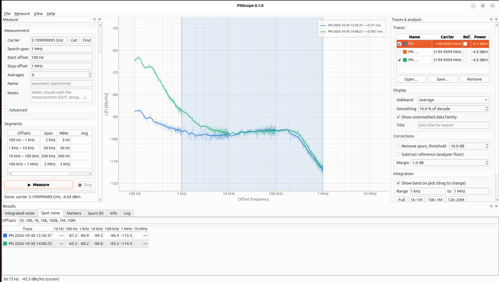
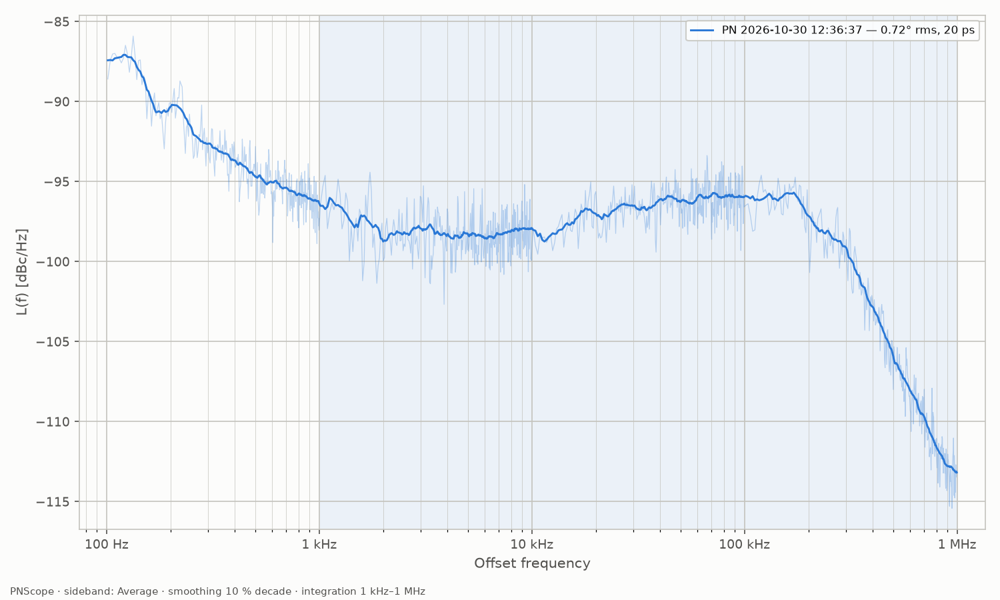

# PNScope

A utility for spectrum analyzers to make phase noise plots and do analysis on them —
for analyzers that have no phase-noise option.

Supported analyzers:

- Siglent SSA3000X series (tested: SSA3075X-R, firmware 3.2.2.6), over LAN
- tinySA Ultra (tested: ZS-406, firmware v1.4-109), over USB; see [tinySA notes](#tinysa-notes)
- ADALM-Pluto / Pluto+ SDR (AD9361; tested: Pluto+ "FISH Ball" Z7020, fw 80403), over LAN/USB via
  libiio; see [PlutoSDR notes](#plutosdr-notes)
- A built-in simulated analyzer, to try the program without hardware

Adding another analyzer (e.g. Rigol RSA3000/5000) is a small driver class, see
[Writing a driver](#writing-a-driver).



## Install and run

```sh
python3 -m venv venv
venv/bin/pip install -e .          # numpy, PySide6, pyqtgraph, matplotlib, pyserial
venv/bin/pnscope [files…]          # or: venv/bin/python -m pnscope
```

### Windows executable

`packaging\build_windows.bat` (run from a Windows command prompt with Python 3.10+ installed)
creates a private build venv, installs PyInstaller and builds `dist\PNScope\PNScope.exe` plus
`dist\PNScope-<version>-windows.zip`. Unzip anywhere and run `PNScope.exe`; no Python needed.
The build settings are in `packaging/pnscope.spec` (also works on Linux:
`pyinstaller packaging/pnscope.spec`).

On GitHub, `.github/workflows/windows.yml` does the same on every push; pushing a tag such as
`v0.2.0` also attaches the zip to a release. The version comes from `pnscope/__init__.py`.

Run the tests with `venv/bin/pip install pytest && venv/bin/python -m pytest`.

## Functionality

The tool makes a plot with logarithmic frequency scale, showing the phase noise L(f) in dBc/Hz.

**Measuring** (left panel)

- Carrier frequency: type it (`1.5805 GHz`, `1580.42M`, …), take the analyzer's centre
  frequency (**Get**), or search the full span for the strongest signal (**Find**). Leave it empty
  to use the analyzer's centre. The carrier is then located precisely within the *search span*,
  and the measurement refuses to start if no clear carrier is there.
- Start / stop offset (e.g. 100 Hz … 1 MHz, or 30 Hz … 10 MHz). The range is split into one
  segment per decade; the table shows span, RBW and averages of each.
- Averages per segment (power averaging of sweeps).
- Advanced: re-centre on the carrier before each segment (tracks slow drift), set the reference
  level to carrier + 5 dB (best dynamic range), restore all analyzer settings afterwards,
  span/RBW ratio, minimum offset in RBWs, VBW ratio.
- The curve builds up live, segment by segment. **Stop** ends after the current sweep and keeps
  the finished segments.

Plots can only be made for CW signals. The analyzer's own phase noise limits what can be
measured: measure a clean generator the same way and use it as the reference trace.

**Analysing** (right panel and results tabs)

- Several traces overlaid; show/hide, rename (double-click), save, remove.
- Sideband: average of both sidebands, upper or lower only.
- Smoothing (moving average on the log axis, display only).
- Spur detection (points more than *threshold* above the local median), listed with level in dBc;
  optional removal (replaced by the local median) before integration.
- **Background measurement** (optional: enable it under Measure → Advanced, then use the
  *Background (DUT off)…* button): select a measurement,
  switch the DUT's RF off and repeat the same segments without carrier. The background trace is
  drawn dotted in the measurement's colour (levels in dBc relative to its carrier), and the spur
  table marks which spurs are also there without carrier ("external": the surroundings, e.g. clock
  harmonics picked up by the cable, or the analyzer) and which come from the DUT. It also shows
  the analyzer's additive noise floor, separately from its phase-noise floor (the "Ref." trace).
- Reference subtraction: mark a trace as **Ref.** (analyzer floor) and subtract it from the others.
  Points within the margin of the floor count as zero noise, so results are a lower bound there.
- Integrated phase noise over a range (type it, use a preset, or drag the band on the plot):
  rms phase in degrees and mrad, integrated dBc, rms jitter, residual FM.
- Spot noise table at chosen offsets (default each decade).
- Markers: double-click the plot or **Add**, drag them, **To peak**; values for every trace, or Δ to M1.
  Double-click a spur to put a marker on it.
- Info tab: carrier, instrument, notes, segment settings, analyzer warnings.

**Export** (File menu)

- Plot as PNG, SVG or PDF (title, legend with integrated results, markers, integration band).
- CSV of the selected trace (both sidebands, average, processed curve, RBW per point).
- Markdown report with all tables and the plot.
- Copy the plot to the clipboard.

Measurements are saved as `.pnscope` files (JSON, raw averaged traces of every segment, so all
analysis can be redone later). The `<label>_meta.json` + `_segN.csv` output of the earlier
scripts (`example/`) opens directly.

## Background

Using the spectrum analyzer's spectrum analysis mode is the most typical, direct and widely
used method to measure phase noise.

The procedure is:

- Measure the carrier power (Pc) in dBm.
- Set a delta marker to a specific frequency offset from the carrier, i.e. a point in the phase noise sideband.
- Measure the noise power (Pn) at that offset, using the noise marker function to normalize the noise measured by the RBW filter to 1 Hz bandwidth.
- Repeat the process at different offsets from the carrier.

What doesn't help, is that in some Siglent firmware versions the delta noise marker function is broken.

Measuring phase noise with very small offsets from the carrier requires a very narrow resolution
bandwidth, to avoid measuring the carrier power instead.

### What PNScope does instead of the noise marker

1. Locate the carrier by zooming in (parabolic interpolation on the peak), and measure Pc with
   a wide RBW so the reading is not affected by the trace-point spacing.
2. For each offset decade, sweep a span of ±(top of the decade) around the carrier with
   RBW ≈ span/600 (≈ one RBW per trace point), RMS (average) detector, power averaging,
   VBW = 3 × RBW, and average N sweeps in the power domain.
3. Keep from each segment only offsets ≥ 10 × RBW (outside the carrier skirt), and stitch:

   `L(f) = P(f) − Pc − 10·log10(1.065 · RBW)`   [dBc/Hz]

   1.065 is the noise bandwidth of a Gaussian RBW filter relative to its 3 dB bandwidth. With an
   RMS detector no log-averaging correction (2.5 dB) is needed.
4. Integration is double-sideband: φ_rms = √(2 ∫ L(f) df), jitter = φ_rms / (2π·fc),
   residual FM = √(2 ∫ L(f)·f² df).

Spur levels are read as P − Pc at the spur's peak (they are not per Hz).

## Code layout

```text
pnscope/
  analyzers/base.py      SpectrumAnalyzer: the abstract interface the measurement uses
  analyzers/scpi.py      SocketTransport + ScpiSpectrumAnalyzer (command table driven)
  analyzers/siglent.py   Siglent SSA3000X driver
  analyzers/simulated.py software analyzer (synthetic carrier, noise and spurs)
  analyzers/registry.py  @register decorator; the GUI lists all registered drivers
  plan.py                offset range -> segments (span, RBW, averages)
  measure.py             PhaseNoiseRun: carrier search, segments, restore; find_carrier()
  model.py               Measurement/Segment, .pnscope files, legacy import
  analysis.py            stitching, sidebands, spurs, smoothing, floor subtraction,
                         integration, spot noise
  export.py              matplotlib figure, CSV, Markdown report
  gui/                   PySide6 + pyqtgraph user interface
```

The measurement and analysis code has no GUI dependency, so it can be scripted:

```python
from pnscope.analyzers import create
from pnscope.measure import PhaseNoiseRun, MeasureSettings
from pnscope.plan import PlanSettings
from pnscope import analysis as A

with create("Siglent SSA3000X", "192.168.10.108") as sa:
    m = PhaseNoiseRun(sa, PlanSettings(start=100, stop=10e6),
                      MeasureSettings(name="dut", carrier_freq=1e9)).run()
m.save("dut.pnscope")
c = A.stitch(m)
print(A.integrate(c.f, c.avg, 1e3, 1e6, m.carrier_freq).phase_deg)
```

## Writing a driver

The measurement needs only what `SpectrumAnalyzer` in `analyzers/base.py` declares: set
centre/span/RBW/VBW, single sweep with an RMS detector and power averaging, read the trace,
reference level, and save/restore the instrument state.

For a SCPI instrument reachable over LAN, subclass `ScpiSpectrumAnalyzer` and override the
command table where the dialect differs. Create `pnscope/analyzers/<vendor>.py`:

```python
from .base import steps_125
from .registry import register
from .scpi import ScpiSpectrumAnalyzer


@register
class RigolRSA(ScpiSpectrumAnalyzer):
    model_name = "Rigol RSA3000/5000"     # shown in the GUI
    needs_host = True
    rbw_steps = steps_125(1, 10e6)        # RBW values the instrument accepts
    min_freq, max_freq = 9e3, 3.2e9

    # Only the entries that differ from the base table (scpi.py). The values below are an
    # UNTESTED sketch — check every command against the programming guide.
    CMD = dict(ScpiSpectrumAnalyzer.CMD,
               detector_rms=":SENS:DET:TRAC RMS",
               average_power=":SENS:AVER:TYPE RMS",
               trace_write=":TRAC1:MODE WRIT",
               rbw=":SENS:BAND:RES {v:g}",
               vbw=":SENS:BAND:VID {v:g}",
               ref_level=":DISP:WIND:TRAC:Y:SCAL:RLEV {v:.1f}",
               **{"ref_level?": ":DISP:WIND:TRAC:Y:SCAL:RLEV?",
                  "trace?": ":TRAC:DATA? TRACE1"})

    # queried with '?' before the measurement and written back afterwards, in this order
    STATE = [":SENS:FREQ:CENT", ":SENS:FREQ:SPAN", ":DISP:WIND:TRAC:Y:SCAL:RLEV",
             ":SENS:BAND:RES", ":SENS:BAND:RES:AUTO", ":SENS:BAND:VID", ":SENS:BAND:VID:AUTO",
             ":SENS:DET:TRAC", ":SENS:AVER:TYPE", ":INIT:CONT"]
```

Then add the module to the import line in `analyzers/__init__.py`. If the trace comes back in
another format (binary block, different separator) override `parse_trace()`; if the instrument
needs a different sweep/wait sequence, override `sweep()`. If the RBW filters are not Gaussian,
set `enbw_factor` or override `enbw_ratio(rbw)`; the value is stored with every segment.
`analyzers/tinysa.py` is an example of a non-SCPI (USB serial shell) driver. Instruments without SCPI over a
socket (USB-TMC, VISA, serial) can subclass `SpectrumAnalyzer` directly, or replace
`SocketTransport` with another class offering `open/close/write/readline/query`.

Points to check when bringing up a new analyzer:

- The detector must average power (RMS/"average" with power scale), not log/video average,
  otherwise noise reads ~2.5 dB low.
- Is the RBW filter Gaussian (noise bandwidth 1.065 × RBW)? If not, adjust `ENBW_GAUSSIAN`.
- Number of trace points: a span/RBW ratio of ~600 suits 751 points; with more points a
  higher ratio is possible (Advanced → Span / RBW).
- On disconnect the driver sends the `local` command (Siglent: `:SYST:LOC`) so the front panel
  works again; set it to the instrument's go-to-local command, or `None` if there is none.
- Compare a clean generator against the simulated / known results, and check that
  `restore_state` leaves the instrument as it was (`save_state()` before == after).

## tinySA notes

Select **tinySA Ultra** and leave the serial port at `auto` (or enter `/dev/ttyACM0`, `COM5`, …).
Sweeps use the `scanraw` command; the screen sweep is paused during the measurement and the
sweep range and RBW (`auto`) are restored afterwards.

- The minimum RBW is 200 Hz, so use a start offset of about 2 kHz or higher (the segment
  table warns below that). A 200 Hz segment takes ~25 s per sweep.
- Its own phase noise is much higher than a bench analyzer's: on a clean 100 MHz generator a
  ZS-406 shows about −91 dBc/Hz at 10–30 kHz, −106 dBc/Hz at 100–300 kHz and −120 dBc/Hz near
  1 MHz. Those values are the tinySA's floor; measure a clean source as reference trace.
- Noise bandwidth per RBW was measured on a ZS-406 (1.22 × RBW at 200 Hz, 1.05–1.14 × at
  1–30 kHz) and is applied automatically.
- Detector: each point combines ~5–20 readings. Peak detection is ruled out, but whether they are
  averaged in power (no error) or in dB (noise reads ~2 dB low) is still open; an absolute
  check against the Siglent with a common noise-like signal would settle it. Until then treat
  tinySA noise readings as ±2 dB.

## PlutoSDR notes

Select **PlutoSDR (AD9361)** and enter the IIO URI (`ip:192.168.2.1`, `usb:1.5.5`, or just the IP).
Needs the libiio system library (Linux: `apt install libiio0`, Windows: ADI's libiio installer) and
`pip install -e .[pluto]` (pylibiio 0.25 for libiio 0.2x).

How it works: each "sweep" is an IQ capture and a Welch spectrum (Blackman-Harris window sized so
its 3 dB width is the RBW; noise bandwidth 1.055 × RBW). Narrow spans put the carrier at +Fs/4,
away from the receiver's DC correction and LO leakage. The receiver gain is set automatically per
segment (manual gain mode) and every capture is normalised to its own carrier power, so gain
and sample-rate changes between segments cancel. The full-span **Find** steps the LO (70 MHz – 6 GHz
in ~2 s). The receiver settings (LO, sample rate, bandwidth, gain mode) are restored afterwards.

- Fast: 100 Hz – 10 MHz with 4 averages takes ~20 s. RBW down to ~1 Hz.
- Close in, its LO phase noise is much lower than the Siglent's: on an SSG3032X at 100 MHz a
  Pluto+ read −99 dBc/Hz at 100 Hz and −109 dBc/Hz at 1 kHz, matching the generator's datasheet.
- Further out it is limited by **additive noise**, not phase noise. For inputs above about
  −45 dBm the AD9361's noise floor is a fixed ~−128 dBFS/Hz (independent of gain and sample
  rate), so with the carrier at about −4.4 dBFS the lowest measurable L(f) is about
  −120…−123 dBc/Hz. (Weaker inputs need more gain, and the floor rises.) Measure a
  **Background** (it uses the same gain per segment as the measurement), mark it **Ref.** and
  subtract it to gain a few dB near the floor.
- Levels are relative: the carrier "dBm" shown is dBFS minus the receiver gain, not calibrated.
- No input filtering: strong signals anywhere within the sampled bandwidth (up to ±30 MHz) reach
  the ADC. Around 100 MHz, FM broadcast stations show up as spurs and raised noise on one
  sideband; use the other sideband (Display → Sideband) or a band-pass filter. The automatic
  gain looks at the strongest signal in the band, so such signals also cost dynamic range.
- Input level: anything from about −45 dBm up to the input limit gives the same floor relative
  to the carrier; below −45 dBm it gets worse.

## Limitations / ideas

- Only CW signals. Future: signal tracking for unstable signals (now: re-centre per segment).
- The analyzer's own phase noise and LO spurs set the floor; readings near it are upper bounds.
- Not yet: limit lines/masks, cross-correlation, AM noise.


